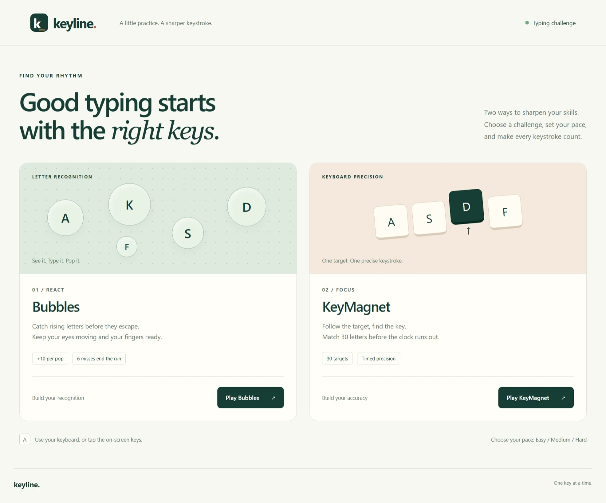
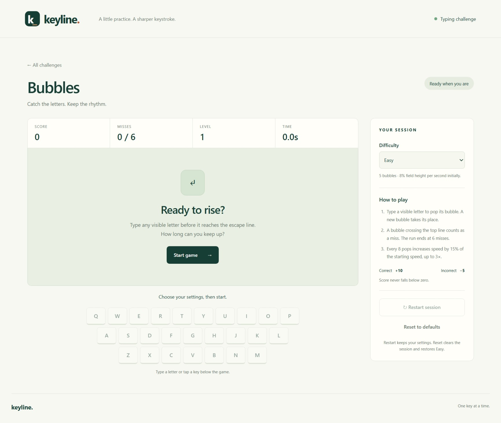
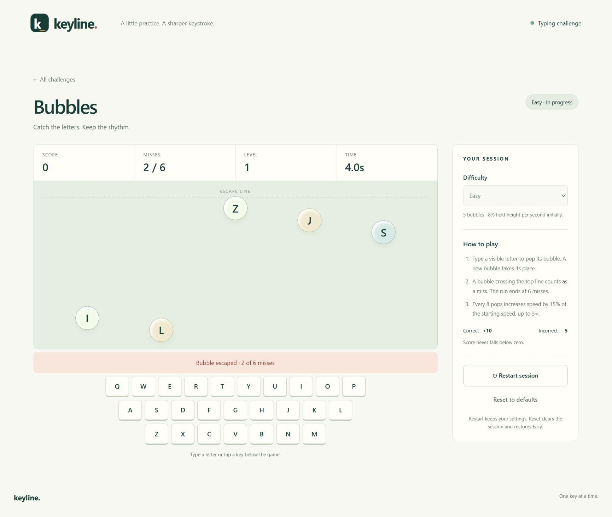
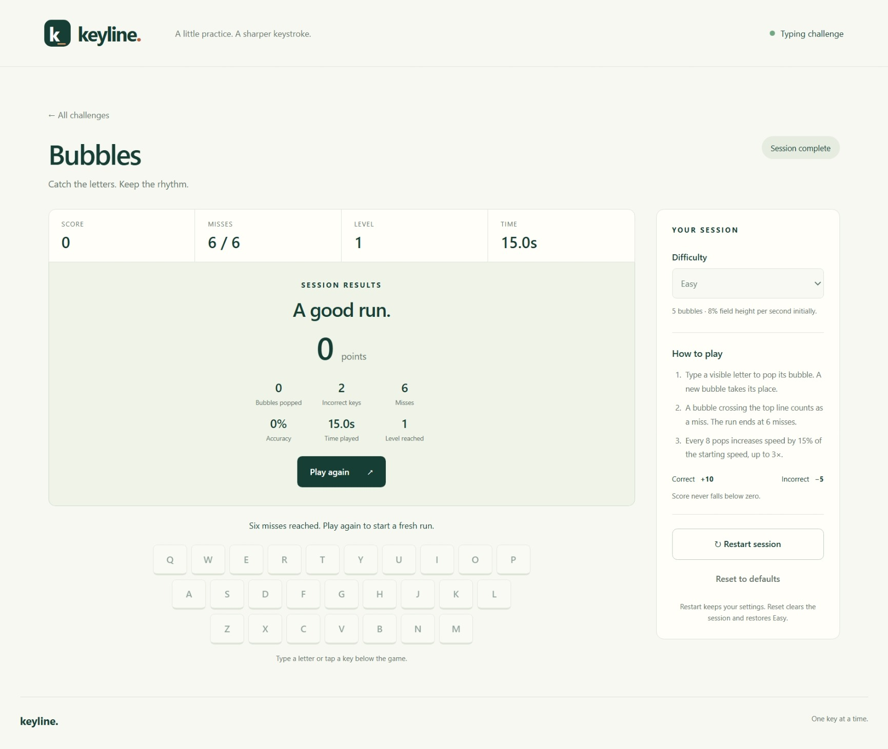
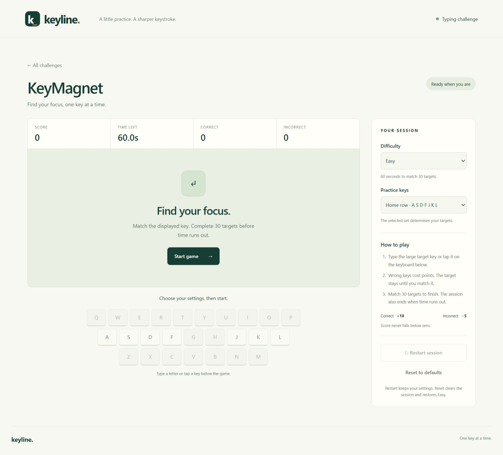
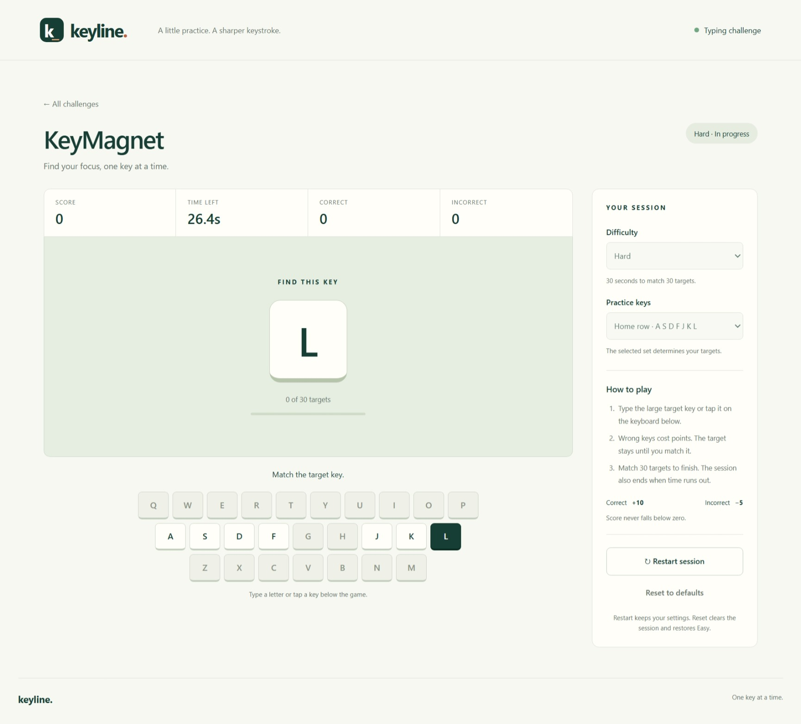
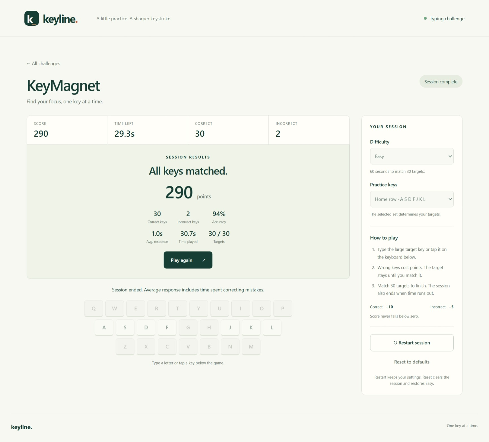

# Keyline — Typing Challenge

Keyline is an interactive typing practice game built with HTML, CSS and JavaScript.
It includes two game modes:

- **Bubbles** — type the letters inside the bubbles before they escape.
- **KeyMagnet** — type the displayed target letter before time runs out.

The project also includes different difficulty levels, an on-screen keyboard, score
tracking and game results.

## How to run

1. Open this project folder in VS Code.
2. Install the **Live Server** extension.
3. Right-click [`dist/index.html`](dist/index.html).
4. Select **Open with Live Server**.

The project will open in your browser and you can start playing from the home screen.

## Screenshots

The [`screenshots`](screenshots) folder contains screenshots of the project.

### Home screen



### Bubbles

#### Before starting



#### During the game



#### After the game



### KeyMagnet

#### Before starting



#### During the game



#### After the game



## Project explanation video

The project explanation video is located in the `video` folder.

video filename: `keyline-project-explanation.mp4`


video filesize: `18.5 MB`

```text
video/keyline-project-explanation.mp4
```

The recorded video size is big, so it maynot be possible to preview it in GitHub. You can download the video and watch it on your local machine.
